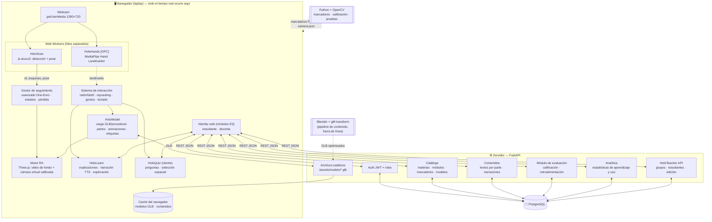
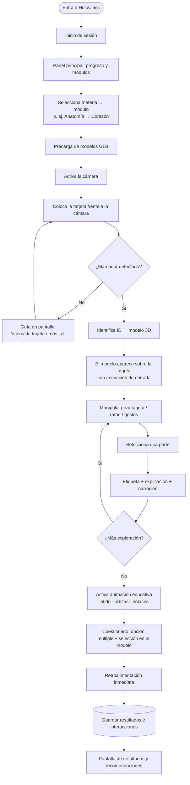
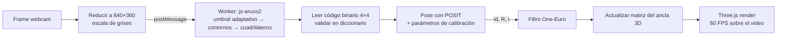
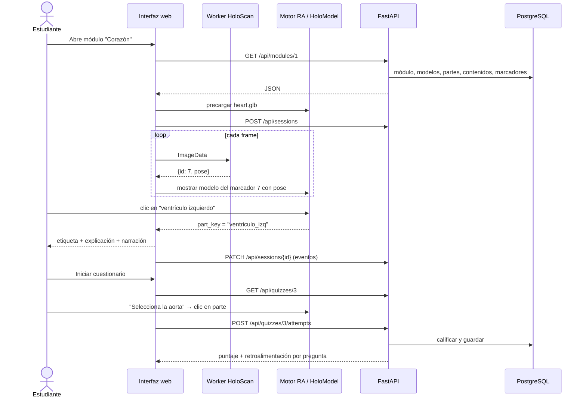

# 02 · Arquitectura y Tecnologías — HoloClass

## 1. Decisión central: ¿qué tipo de realidad aumentada?

| Enfoque | Cómo funciona | Estabilidad en laptop | Costo | Dificultad | Veredicto |
|---------|---------------|:---:|:---:|:---:|-----------|
| **RA con marcadores fiduciales (ArUco) en navegador** | Cuadros blanco/negro con código binario; se detectan con geometría simple y dan pose exacta | ⭐⭐⭐⭐⭐ | $0 | Media | ✅ **Elegido** |
| RA con imagen natural (MindAR, AR.js NFT) | Reconoce la ilustración misma por puntos característicos | ⭐⭐⭐ (sensible a luz, textura y desenfoque; más CPU) | $0 | Media | 🔶 [FUTURO] para tarjetas personalizadas del docente |
| RA sin marcadores / WebXR (planos) | Detecta superficies del entorno | ❌ Requiere celular con ARCore/ARKit; no funciona con webcam de laptop | $0 | Alta | ⚪ [FUTURO] versión móvil |
| Visores (HoloLens, Quest) | Gafas de RA/RV | ⭐⭐⭐⭐ | $10,000 – $70,000 MXN por visor | Alta | ❌ Fuera de presupuesto y de la realidad escolar |
| Plataformas comerciales (8th Wall, Vuforia) | SDK propietario | ⭐⭐⭐⭐ | Licencias / marcas de agua | Media | ❌ Costo y dependencia |

**Conclusión:** la **RA basada en marcadores ArUco dentro de una aplicación web** es la mejor opción para este proyecto porque:
1. **Estabilidad:** ArUco detecta el marcador por sus bordes y su código binario, lo que lo hace robusto ante cambios de luz y rápido (milisegundos por frame). Para una demo en vivo, la estabilidad es lo más importante.
2. **Pose precisa:** las 4 esquinas conocidas permiten calcular la posición y orientación 3D con `solvePnP`/POSIT, por lo que el modelo "se pega" a la tarjeta y la sigue al girarla.
3. **Identificación sin ambigüedad:** cada marcador tiene un **ID** → asociación directa en la BD con un modelo 3D. No hay falsos positivos entre tarjetas.
4. **Accesibilidad:** solo una laptop y papel. Sin instalar nada: se abre una URL.
5. **Tarjetas atractivas:** el marcador ocupa una esquina o marco de la tarjeta; el resto se usa para la ilustración y el texto.

### 1.1 ¿Dónde se detecta el marcador: Python o navegador?

| Alternativa | Pros | Contras | Veredicto |
|-------------|------|---------|-----------|
| A. **Python + OpenCV** detecta y envía la pose al navegador por WebSocket | `cv2.aruco` es la referencia, muy precisa | Viaje ida y vuelta de cada frame → retraso visible y "temblor" del modelo; servidor obligatorio | ❌ para tiempo real |
| B. **Navegador: js-aruco2** (JS puro) en un *Web Worker* | Sin latencia de red, 30+ FPS, funciona offline, soporta diccionarios ArUco estándar y pose (POSIT) | Algo menos preciso que OpenCV | ✅ **Elegido** |
| C. Navegador: OpenCV.js (WASM) con módulo aruco | Mismas funciones que OpenCV | Archivo de ~8–10 MB, compilación personalizada para incluir aruco | 🔶 Plan B si js-aruco2 no da precisión suficiente |

**Rol de Python + OpenCV en el proyecto:** herramientas de ingeniería *fuera de línea*:
- Generar los marcadores ArUco imprimibles (`cv2.aruco.generateImageMarker`).
- **Calibrar la webcam** con un tablero ChArUco (obtener distancia focal y distorsión) → los parámetros se cargan en el navegador para una pose más precisa.
- Banco de pruebas: medir tasa de detección por distancia, ángulo e iluminación con videos grabados (para el reporte de métricas).

---

## 2. Comparación y uso de cada tecnología

| Tecnología | ¿Se usa? | Dónde y para qué | Alternativa considerada |
|------------|:---:|------------------|-------------------------|
| **JavaScript (ES2022)** | ✅ | Lenguaje del frontend, RA e interacción | TypeScript [OPCIONAL] si el equipo lo domina |
| **JavaScript con módulos ES** (implementado) | ✅ | SPA: pantallas, rutas por hash, estado, panel docente — sin paso de compilación | React 18 + Vite (propuesta original; descartado para publicar directo en GitHub Pages) |
| **Three.js (r16x)** | ✅ | Motor 3D: escena, cámara virtual, luces, carga GLB, animaciones, raycasting para seleccionar partes, planos de corte | Babylon.js (completo, pero más pesado y con menos ejemplos con React) |
| **Three.js addons** (OrbitControls, GLTFLoader, meshopt) | ✅ | Cámara orbital en modo fijado, carga de modelos GLB del docente; etiquetas como HTML proyectado | React Three Fiber + drei (solo tendría sentido con React) |
| **WebGL 2** | ✅ (vía Three.js) | Aceleración gráfica con la GPU integrada | WebGPU [FUTURO] |
| **ArUco** | ✅ | Marcadores fiduciales de las tarjetas (diccionario `ARUCO_MIP_36h12`, idéntico en js-aruco2 y OpenCV) | AprilTag (similar), QR (no da pose estable) |
| **js-aruco2** | ✅ | Detección de marcadores y pose en el navegador | OpenCV.js |
| **OpenCV (Python)** | ✅ | Generación de marcadores, calibración, pruebas de rendimiento | — |
| **Python 3.11** | ✅ | Backend y scripts de herramientas | Node.js (posible, pero el equipo ya domina Python y se reutiliza con OpenCV) |
| **MediaPipe Tasks Vision (Hand Landmarker, JS)** | 🔶 [OPCIONAL] | HoloHands: 21 puntos por mano en el navegador → gestos de pellizco, rotación y señalar | TensorFlow.js Handpose (más lento) |
| **Blender 4.x** | ✅ | Limpieza, segmentación por partes, nombres, reducción de polígonos, animaciones (latido), exportación GLB | — |
| **glTF 2.0 / GLB** | ✅ | Formato estándar de modelos para web (un solo archivo con malla, materiales, texturas y animaciones) | FBX/OBJ (no son óptimos para web) |
| **gltf-transform (CLI)** | ✅ | Compresión Draco/meshopt, texturas WebP/KTX2, reducción de peso | gltfpack |
| **FastAPI** | ✅ | API REST: autenticación, módulos, contenidos, cuestionarios, resultados, estadísticas | Flask (más simple, pero sin validación ni documentación automáticas) |
| **PostgreSQL 16** | ✅ | Usuarios, contenidos, marcadores, resultados, eventos de interacción | SQLite (válido en demo, menos adecuado multiusuario) |
| **Web Speech API (`speechSynthesis`)** | ✅ | Narración en español | Archivos MP3 pregrabados (mejor voz; se pueden usar para la demo) |
| **Recharts** | ✅ | Gráficas del panel docente | Chart.js |
| **Tailwind CSS + shadcn/ui** | ✅ | Interfaz moderna y consistente | Material UI |

**¿Por qué FastAPI y no Flask?** Validación automática con Pydantic, documentación Swagger en `/docs` (útil para mostrar al jurado y para que el frontend trabaje en paralelo) y rendimiento asíncrono. La curva de aprendizaje es similar.

---

## 3. Arquitectura del sistema

### 3.1 Diagrama de arquitectura



**Principio de diseño:** *el tiempo real nunca depende del servidor.* La cámara, la detección, el render y la interacción corren en el navegador. El servidor solo entrega contenido y guarda resultados. Si se pierde la red durante la demo, la RA sigue funcionando (los resultados se guardan en cola y se sincronizan después).

### 3.2 Componentes

| Componente | Responsabilidad | Detalle técnico |
|------------|-----------------|-----------------|
| **HoloScan** | Detectar marcadores y su pose | Frame reducido a 640×360 → `ImageData` → Worker → js-aruco2 (`AR.Detector` + `POS.Posit`) → `{id, corners, rotation, translation}` |
| **Gestor de seguimiento** | Estabilidad | Filtro **One-Euro** sobre posición y cuaternión (elimina temblor sin retraso perceptible); máquina de estados *buscando → detectado → seguido → perdido* |
| **Motor RA** | Superponer el 3D sobre el video | `<video>` de fondo + `<canvas>` WebGL transparente encima; cámara virtual de Three.js con el FOV de la webcam (calibración); modo espejo coherente |
| **HoloModel** | Contenido 3D | Carga GLB (Draco/meshopt), mapa `nombre de malla → parte`, `AnimationMixer`, vista explosionada, planos de corte; moléculas construidas con `InstancedMesh` |
| **Interacción** | Entrada del usuario | `Raycaster` para seleccionar partes, rotación/zoom con ratón o rueda, gestos [OPC], atajos de teclado |
| **HoloLearn** | Pedagogía | Panel de información por parte, TTS, recorrido guiado (pasos), exploración libre |
| **HoloQuiz** | Evaluación | Renderiza preguntas; las espaciales esperan un `part_key` seleccionado en el modelo |
| **Backend** | Datos y reglas | Auth, catálogo, calificación en servidor (evita trampas), analítica |
| **Pipeline de contenido** | Producción | Blender → GLB → gltf-transform → `/assets/models` + registro en BD |

### 3.3 Endpoints principales

| Método | Ruta | Descripción |
|--------|------|-------------|
| POST | `/api/auth/login` · `/api/auth/register` | Autenticación (JWT con rol) |
| GET | `/api/subjects` | Materias con sus módulos |
| GET | `/api/modules/{id}` | Módulo: modelos, marcadores, partes, contenidos |
| GET | `/api/markers` | Mapa `marker_code → model` (se cachea al iniciar) |
| POST | `/api/sessions` · PATCH `/api/sessions/{id}` | Inicio/fin de sesión de exploración + eventos (partes vistas, tiempo, animaciones) |
| GET | `/api/quizzes/{id}` | Cuestionario sin respuestas correctas |
| POST | `/api/quizzes/{id}/attempts` | Envía respuestas → calificación y retroalimentación |
| GET | `/api/me/progress` | Progreso del estudiante |
| GET/POST/PATCH | `/api/teacher/groups`, `/students`, `/modules`, `/contents`, `/questions` | Gestión docente |
| GET | `/api/teacher/stats?group_id=` | Estadísticas por grupo, módulo y pregunta |

---

## 4. Diagramas de flujo

### 4.1 Flujo general del estudiante



### 4.2 Pipeline de RA (por frame)



### 4.3 Manejo de pérdida de seguimiento

```mermaid
stateDiagram-v2
    [*] --> Buscando
    Buscando --> Detectado: marcador visto en 3 frames seguidos
    Detectado --> Seguido: pose estable
    Seguido --> Seguido: marcador visible (actualiza pose filtrada)
    Seguido --> Perdido: no visible
    Perdido --> Seguido: reaparece < 600 ms (sin parpadeo; se mantiene la última pose)
    Perdido --> Desvaneciendo: > 600 ms
    Desvaneciendo --> Seguido: reaparece
    Desvaneciendo --> Buscando: > 1.5 s → aviso "vuelve a mostrar la tarjeta"
    Seguido --> Anclado: botón "📌 Fijar en pantalla"
    Anclado --> Seguido: botón "Volver a la tarjeta"
```



El modo **Anclado** es clave para la experiencia: el estudiante puede soltar la tarjeta y seguir explorando con el ratón, contestar el cuestionario o leer con calma, sin cansar el brazo.

### 4.4 Secuencia: tarjeta → modelo → cuestionario



---

## 5. Estructura del repositorio (implementada)

```
02_HoloClass/
├── app/                            # interfaz web (módulos ES, sin compilación)
│   ├── index.html · styles.css · tarjetas.html · camera.json
│   ├── data/content.json           # contenido educativo único (modo local y base de datos)
│   └── js/
│       ├── main.js                 # sesión, navegación, inicio
│       ├── store.js                # LocalStore (navegador) / ApiStore (FastAPI)
│       ├── ar.js · aruco-worker.js # HoloScan: Worker + POSIT + One-Euro + reacciones
│       ├── models.js               # corazón, sistema solar, moléculas, Bohr, GLB
│       ├── viewer.js · quiz.js     # HoloLearn + HoloQuiz
│       ├── hands.js                # HoloHands (MediaPipe, beta)
│       └── teacher.js              # HoloTeacher
├── backend/                        # FastAPI + SQLAlchemy (+ tests/ con pytest)
├── tools/                          # Python + OpenCV
│   ├── generate_markers.py         # PNG/PDF de tarjetas
│   ├── calibrate_camera.py         # ChArUco → app/camera.json
│   └── benchmark_detection.py      # métricas de detección
└── database/schema.sql             # generado desde backend/app/models.py
```

> **Nota de implementación:** el diseño original proponía React + Vite + React Three Fiber. Se implementó con **JavaScript en módulos ES y Three.js directo** para publicar sin compilación (GitHub Pages) y simplificar la depuración. El diccionario final es **ARUCO_MIP_36h12** (distancia de Hamming 12). Ver [10_Implementacion.md](10_Implementacion.md#4-decisiones-que-cambiaron-respecto-al-diseño-original).
