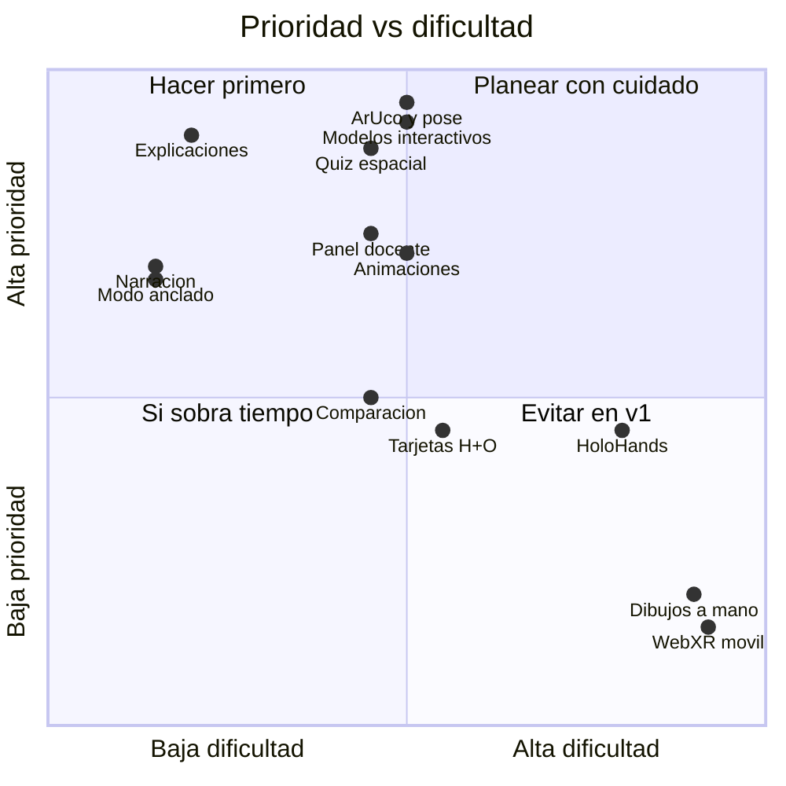

# 03 · Módulos Funcionales — HoloClass

Leyenda: **[MVP]** se implementa y se demuestra · **[OPCIONAL]** solo si el MVP está estable en la semana 6 · **[FUTURO]** mejora posterior.

---

## 4. Funcionamiento general (flujo de 12 pasos)

| # | Paso | Qué ocurre técnicamente | Qué ve el usuario |
|---|------|-------------------------|-------------------|
| 1 | Entra a la plataforma | SPA React; login → JWT con rol (estudiante/docente) | Pantalla de inicio de sesión |
| 2 | Selecciona materia/módulo | `GET /api/subjects` y `GET /api/modules/{id}`; se precargan los GLB del módulo y se cachean | Tarjetas de materias → módulos con progreso |
| 3 | Se activa la cámara | `getUserMedia`; se cargan parámetros de calibración (`camera.json`) | Video en vivo con marco guía "Muestra tu tarjeta aquí" |
| 4 | Coloca la tarjeta | Se envían frames al Worker de HoloScan (~30 detecciones/s) | Indicador de búsqueda animado |
| 5 | Identifica el marcador | js-aruco2 detecta el ID; se confirma con 3 frames consecutivos; se busca en el mapa `marker → modelo` | Contorno verde sobre la tarjeta + nombre del tema |
| 6 | Muestra el modelo 3D | Three.js coloca el modelo en el ancla con la pose filtrada; animación de entrada (escala 0 → 1) | El corazón "brota" de la tarjeta |
| 7 | Manipula el modelo | Girar/inclinar la tarjeta físicamente (pose), rueda = zoom, arrastrar = rotación extra, [OPC] gestos | El modelo sigue la tarjeta en tiempo real |
| 8 | Selecciona partes | `Raycaster` desde el puntero (o dedo índice [OPC]) → malla → `part_key`; resaltado con contorno | La parte se ilumina; las demás se vuelven semitransparentes |
| 9 | Explicaciones y etiquetas | Contenido de la parte desde la BD; etiqueta 3D anclada (`<Html>` de drei) | Etiqueta flotante + panel lateral con explicación, dato curioso e imagen |
| 10 | Narración de voz | `speechSynthesis` (es-MX) o MP3 pregrabado | Botón 🔊; se resalta el texto mientras se lee |
| 11 | Actividad o cuestionario | HoloQuiz: opción múltiple + selección espacial en el modelo | Preguntas con temporizador opcional y retroalimentación |
| 12 | Registro de resultados | `POST /attempts`; eventos de la sesión (partes vistas, tiempo, animaciones) | Resumen: puntaje, aciertos por concepto, recomendación de repaso |

---

## A. HoloScan — Reconocimiento de marcadores

| Función | Estado | Implementación |
|---------|--------|----------------|
| Captura mediante webcam | [MVP] | `getUserMedia` 1280×720; selector de cámara si hay varias |
| Reconocimiento de tarjetas | [MVP] | Cada tarjeta = ilustración + marcador ArUco `DICT_4X4_50` con ID único |
| Detección de marcadores | [MVP] | js-aruco2 en Web Worker sobre frame reducido a 640×360 |
| Seguimiento de posición y orientación | [MVP] | Pose 6DoF (POSIT) + filtro One-Euro |
| Asociación marcador → modelo 3D | [MVP] | Tabla `marker` en BD; mapa cacheado en el cliente |
| Manejo de pérdida de seguimiento | [MVP] | Retención 600 ms, desvanecido, aviso, modo **Anclado** |
| Múltiples marcadores a la vez | [MVP] | Hasta 4 simultáneos (comparación de modelos) |
| Guía de calidad de imagen | [MVP] | Si no hay detección en 3 s: mensajes "acerca la tarjeta", "evita reflejos", "más luz" (brillo medio del frame) |
| Calibración de la cámara | [MVP] (una vez por laptop de demo) | Script Python con tablero ChArUco → `camera.json`; si no hay calibración, se usa FOV estimado |
| Interacción entre tarjetas (proximidad) | [OPCIONAL] | Distancia entre poses < umbral → evento (p. ej., H + O → H₂O) |
| Tarjetas con imagen propia del docente (image tracking) | [FUTURO] | MindAR |
| Reconocimiento de dibujos hechos a mano | [FUTURO] | Clasificador CNN (estilo "Quick, Draw!") |

### Diseño de las tarjetas
- Tamaño media carta o 10×15 cm, cartulina mate, enmicado **mate** (evita reflejos).
- Marcador de **5×5 cm** en la esquina superior derecha con margen blanco (zona de silencio) de 1 cm.
- Ilustración atractiva, título, materia (color por materia) y un **QR pequeño** en el reverso que abre el módulo en modo escritorio.
- Generadas por `tools/generate_markers.py` + plantilla de Canva/Figma.

**Juego de tarjetas v1 (18):** Corazón exterior, Corazón corte, Circulación · Sistema solar, Sol, Mercurio, Venus, Tierra, Marte, Júpiter, Saturno, Urano, Neptuno · Átomo (Bohr), H₂O, CO₂, CH₄, Glucosa. Más 1 tarjeta "comodín" del docente.

---

## B. HoloModel — Visualización tridimensional

| Función | Estado | Detalle |
|---------|--------|---------|
| Modelos 3D | [MVP] | GLB optimizados (corazón, planetas) y moléculas procedurales |
| Rotación | [MVP] | Física (girar la tarjeta) + virtual (arrastrar con ratón) |
| Zoom | [MVP] | Rueda/pellizco táctil; límites mín./máx. |
| Selección de componentes | [MVP] | Raycasting; cada malla del GLB nombrada con su `part_key` |
| Animaciones | [MVP] | Latido (shape keys/armature), órbitas (código), electrones (código), rotación molecular |
| Etiquetas informativas | [MVP] | Etiquetas 3D con línea guía; botón "mostrar todas" |
| Visualización en tiempo real | [MVP] | ≥ 30 FPS objetivo en laptop con gráficos integrados |
| Vista explosionada | [MVP] | Desplaza cada parte a lo largo de un vector desde el centro (animado) |
| Corte transversal | [MVP] (corazón) | `clippingPlanes` de Three.js con control deslizante |
| Escala real vs didáctica | [MVP] (sistema solar) | Interruptor que cambia tamaños/distancias |
| Comparación de modelos | [MVP] | Dos tarjetas → dos modelos con escala relativa; tabla comparativa |
| Modo rayos X (transparencia) | [OPCIONAL] | Material semitransparente para ver estructuras internas |
| Simulaciones físicas | [FUTURO] | |

---

## C. HoloLearn — Aprendizaje interactivo

| Función | Estado | Detalle |
|---------|--------|---------|
| Explicaciones por componente | [MVP] | Título, descripción breve (≤ 80 palabras), función, dato curioso, nivel (básico/avanzado) |
| Narración de voz | [MVP] | TTS español; para la demo, MP3 pregrabados del corazón (mejor calidad) |
| Información complementaria | [MVP] | Panel "Saber más" con texto extendido y referencias |
| **Recorrido guiado** | [MVP] | Secuencia de pasos: la cámara virtual enfoca cada parte, la resalta y la narra ("Paso 3 de 8: el ventrículo izquierdo…") |
| **Exploración libre** | [MVP] | El estudiante decide qué tocar; se marca cuáles partes ya vio (barra de progreso "6/8 partes exploradas") |
| Actividades educativas | [MVP] | "Encuentra la parte" (búsqueda guiada sin evaluación) y "ordena el recorrido de la sangre" |
| Evaluación de conocimientos | [MVP] | Vía HoloQuiz |
| Niveles de dificultad por grado escolar | [OPCIONAL] | Secundaria / bachillerato |
| Tutor conversacional con IA | [FUTURO] | |

**Diseño pedagógico:** cada módulo sigue el ciclo **Engage → Explore → Explain → Evaluate** (modelo 5E simplificado): animación de entrada que capta atención, exploración libre, explicación guiada con narración y cuestionario. El sistema exige haber explorado al menos el 60 % de las partes antes de habilitar el cuestionario (configurable por el docente).

---

## D. HoloHands — Interacción mediante manos [OPCIONAL]

| Función | Estado | Gesto |
|---------|--------|-------|
| Detección de manos | [OPCIONAL] | MediaPipe Hand Landmarker (21 puntos) en Worker, a 15 Hz |
| Rotar modelo | [OPCIONAL] | Mano abierta y desplazamiento horizontal/vertical |
| Acercar/alejar | [OPCIONAL] | Distancia entre pulgar e índice de las dos manos (o pellizco y arrastre con una) |
| Selección | [OPCIONAL] | Apuntar con el índice + pellizco breve (pulgar-índice < umbral durante 300 ms) |
| Navegación | [OPCIONAL] | Deslizar a izquierda/derecha = siguiente/anterior paso del recorrido |

**Regla de estabilidad:**
- HoloHands solo se activa **en modo Anclado** (el modelo fijo en pantalla), para no competir con el seguimiento de la tarjeta ni confundir manos con tarjetas.
- Se ejecuta en un Worker separado a 15 Hz; si los FPS de render caen por debajo de 25, se desactiva automáticamente y se avisa.
- Interruptor visible "✋ Gestos (beta)"; el ratón y el teclado siempre funcionan.
- Se decide en la semana 6 si entra a la demo, según las pruebas de rendimiento.

---

## E. HoloQuiz — Evaluación

| Función | Estado | Detalle |
|---------|--------|---------|
| Cuestionarios por tema | [MVP] | 1–2 por módulo, 5–10 preguntas, banco aleatorizado |
| Opción múltiple | [MVP] | 4 opciones, una correcta, retroalimentación por opción |
| **Preguntas sobre el modelo (selección espacial)** | [MVP] | "Selecciona la parte que bombea sangre oxigenada al cuerpo" → el estudiante toca la parte en el modelo 3D → se compara `part_key` |
| Verdadero/falso | [MVP] | |
| Puntuaciones | [MVP] | Porcentaje, aciertos, tiempo; estrellas (1–3) para motivar |
| Registro de resultados | [MVP] | `quiz_attempt` + `attempt_answer` |
| Estadísticas de aprendizaje | [MVP] | Por estudiante, por pregunta, por concepto (etiqueta de la pregunta) |
| Pre-test / post-test | [MVP] | Mismo banco, para medir la ganancia de aprendizaje en el piloto |
| Pregunta de ordenamiento (secuencia) | [OPCIONAL] | Recorrido de la sangre |
| Modo competencia en clase (tipo concurso en tiempo real) | [FUTURO] | |

**Calificación en el servidor:** el cliente no recibe las respuestas correctas; el backend califica y devuelve la retroalimentación. Las preguntas con respuesta espacial guardan `correct_part_id`.

---

## F. HoloTeacher — Panel docente

| Función | Estado | Detalle |
|---------|--------|---------|
| Gestión de estudiantes | [MVP] | Crear grupos, alta de estudiantes (individual o CSV), código de grupo para auto-registro |
| Consulta de resultados | [MVP] | Tabla por estudiante y por cuestionario; detalle de respuestas |
| Estadísticas de utilización | [MVP] | Sesiones, tiempo de exploración, partes más/menos vistas, módulos más usados |
| Administración de contenidos | [MVP] | Editar explicaciones por parte, narración, preguntas y opciones |
| Creación de módulos | [MVP limitado] | Crear módulo a partir de un **GLB ya preparado**: subir archivo, se listan sus mallas, el docente las nombra como partes, asigna un marcador libre y escribe textos/preguntas |
| Asignar módulos a grupos con fecha | [OPCIONAL] | |
| Exportar resultados a CSV/Excel | [OPCIONAL] | |
| Editor 3D o generador de modelos | [FUTURO] | |
| Integración con Classroom/Moodle | [FUTURO] | |

**Indicadores destacados en el panel:**
- "Pregunta más fallada del grupo" con la parte del modelo asociada → el docente sabe **qué concepto reforzar**.
- Correlación simple *tiempo de exploración vs. puntaje*.
- Mapa de calor de partes del modelo más consultadas.

---

## 12. Funciones diferenciales — prioridad y dificultad

| Función | Prioridad | Dificultad | Decisión |
|---------|-----------|------------|----------|
| Reconocimiento de tarjetas (ArUco) con pose | 🔴 Crítica | Media | [MVP] |
| Modelos 3D interactivos (rotar, zoom, seleccionar) | 🔴 Crítica | Media | [MVP] |
| Explicaciones por componente | 🔴 Crítica | Baja | [MVP] |
| Evaluaciones ligadas al modelo (selección espacial) | 🔴 Crítica | Media | [MVP] — **principal diferenciador pedagógico** |
| Animaciones educativas (latido, órbitas, electrones) | 🟠 Alta | Media | [MVP] |
| Narración por voz | 🟠 Alta | Baja | [MVP] |
| Modo exploración libre + recorrido guiado | 🟠 Alta | Baja | [MVP] |
| Modo Anclado (soltar la tarjeta) | 🟠 Alta | Baja | [MVP] |
| Comparación de modelos (2 tarjetas) | 🟡 Media | Media | [MVP] (sistema solar) |
| Vista explosionada / corte | 🟡 Media | Media | [MVP] (corazón) |
| Panel docente con analítica | 🟠 Alta | Media | [MVP] |
| Interacción entre tarjetas (H + O → H₂O) | 🟡 Media | Media | [OPCIONAL] — gran efecto en feria |
| Manipulación por gestos (HoloHands) | 🟡 Media | Alta | [OPCIONAL] |
| Modelo del cerebro | 🟢 Baja | Media | [OPCIONAL] |
| Tarjetas personalizadas del docente (image tracking) | 🟢 Baja | Alta | [FUTURO] |
| Reconocimiento de dibujos a mano | 🟢 Baja | Alta | [FUTURO] |
| RA móvil sin marcadores (WebXR) | 🟢 Baja | Alta | [FUTURO] |

