# 04 · Modelos 3D — HoloClass

## 1. Estrategia general

| Módulo | Estrategia | Por qué |
|--------|-----------|---------|
| 🫀 Corazón | **Descargar modelo con licencia abierta → adaptar en Blender** (segmentar partes, animar, optimizar) | Modelar un corazón anatómico desde cero no es viable en 8 semanas |
| 🪐 Sistema solar | **Generar esferas en Three.js + texturas con licencia abierta**; anillos de Saturno como plano con textura | Las esferas no requieren modelado; todo el peso está en las texturas |
| ⚛️ Química | **Generación procedural por código** desde JSON (coordenadas atómicas públicas) | Escalable: agregar una molécula = agregar un archivo de datos |
| Modelo de Bohr | Procedural (núcleo + órbitas + electrones animados) | Sencillo y parametrizable por elemento |

## 2. Fuentes de modelos y texturas gratuitas (revisar SIEMPRE la licencia)

| Fuente | Contenido útil | Licencia habitual | Notas |
|--------|----------------|-------------------|-------|
| **BodyParts3D** (DBCLS, Japón) | Mallas anatómicas segmentadas (incluye corazón por partes) | CC BY-SA 2.1 JP | Excelente porque ya viene segmentado; obliga a atribución y a compartir derivados con la misma licencia |
| **NIH 3D** (3d.nih.gov) | Modelos anatómicos y biomédicos | Varía por modelo (muchos CC BY / dominio público) | Revisar cada ficha |
| **Sketchfab** (filtro *Downloadable* + licencia) | Corazones y órganos estilizados de alta calidad | CC BY, CC BY-SA, CC BY-NC, CC0 | Usar **CC0 o CC BY** para no limitar la comercialización; **evitar NC/ND** si se quiere vender después |
| **Smithsonian 3D Digitization** | Objetos científicos | Muchos CC0 | |
| **NASA 3D Resources / NASA Science** | Planetas, naves, superficies | Guía de uso de medios de la NASA (generalmente sin copyright, no implica respaldo de la NASA) | No usar logotipos de la NASA como si fuera respaldo oficial |
| **Solar System Scope Textures** | Texturas 2K/8K de planetas, anillo de Saturno, nubes de la Tierra | CC BY 4.0 | Requiere atribución |
| **Poly Haven** | Texturas, HDRIs para iluminación | CC0 | |
| **PubChem (NIH)** | Coordenadas 3D de moléculas (formato SDF/JSON) | Datos de dominio público | Se convierten a JSON propio con un script Python |

### 2.1 Registro obligatorio de licencias

Cada recurso se anota en `content/LICENSES.md` **antes** de usarlo:

| Recurso | Archivo | Autor | Fuente (URL) | Licencia | Atribución requerida | ¿Modificado? | ¿Permite uso comercial? |
|---------|---------|-------|--------------|----------|----------------------|--------------|------------------------|
| Corazón | heart.glb | (autor) | (URL) | CC BY 4.0 | Sí | Segmentado, decimado, animado | Sí |

Además, la aplicación tiene una pantalla **"Créditos"** con todas las atribuciones (requisito de CC BY). Regla del equipo: **ningún modelo entra al repositorio sin su fila en LICENSES.md**; el integrante 5 lo revisa en cada integración semanal.

## 3. Pipeline de preparación en Blender (corazón como ejemplo)

```mermaid
flowchart LR
    A[Descargar modelo<br/>+ registrar licencia] --> B[Importar en Blender<br/>revisar escala y orientación]
    B --> C[Limpiar<br/>eliminar ocultos, unir vértices,<br/>recalcular normales]
    C --> D[Segmentar en partes<br/>1 objeto = 1 parte seleccionable]
    D --> E[Nombrar objetos con part_key<br/>auricula_der, ventriculo_izq…]
    E --> F[Reducir polígonos<br/>Decimate → presupuesto]
    F --> G[Materiales PBR simples<br/>hornear texturas 1K–2K]
    G --> H[Animaciones<br/>latido con shape keys<br/>vista explosionada por código]
    H --> I[Punto de origen y escala<br/>centro en 0,0,0 · tamaño ≈ marcador]
    I --> J[Exportar GLB<br/>+Y arriba, aplicar transformaciones,<br/>incluir animaciones]
    J --> K[gltf-transform<br/>meshopt/Draco + WebP/KTX2]
    K --> L[Probar en three.js editor<br/>y en laptop de gama media]
    L --> M[Registrar en BD<br/>model_3d + model_part]
```



### Pasos clave explicados
1. **Segmentación y nombres:** HoloClass selecciona partes por el **nombre de la malla**. Si el modelo viene como una sola malla, se separa en Blender (modo edición → seleccionar → `P` → *Selection*). Convención: `snake_case` sin acentos, igual al `part_key` de la BD.
2. **Origen y escala:** el modelo se centra en el origen y se escala para que mida ~1.5 veces el ancho del marcador; así "brota" de la tarjeta con proporción natural.
3. **Latido:** dos *shape keys* (contraído/relajado) animadas en un ciclo de ~0.8 s (≈ 75 lpm), exportadas como animación glTF y reproducidas con `AnimationMixer` (velocidad ajustable). Alternativa más simple: escalar ventrículos y aurículas con desfase por código.
4. **Flujo sanguíneo:** curvas (Bezier) en Blender exportadas como puntos → en Three.js partículas rojas/azules que recorren la trayectoria.
5. **Etiquetas:** en Blender se agrega un objeto vacío (*Empty*) por parte llamado `label_<part_key>` en el punto donde debe ir la etiqueta; Three.js lo lee al cargar y coloca ahí la etiqueta HTML.
6. **Materiales:** PBR básico (color base + rugosidad). Se evitan materiales con nodos complejos que glTF no exporta.

### Moléculas (procedural)
```json
{
  "id": "h2o", "name": "Agua", "formula": "H₂O",
  "atoms": [
    {"el": "O", "pos": [0.000, 0.000, 0.000]},
    {"el": "H", "pos": [0.757, 0.586, 0.000]},
    {"el": "H", "pos": [-0.757, 0.586, 0.000]}
  ],
  "bonds": [[0, 1, 1], [0, 2, 1]],
  "facts": {"geometry": "angular", "bond_angle": 104.5}
}
```
`MoleculeBuilder.js` crea esferas con el radio y color CPK de cada elemento (O rojo, H blanco, C gris, N azul) usando `InstancedMesh` (1 llamada de dibujo por elemento) y cilindros para los enlaces. Un script Python convierte los archivos SDF de PubChem a este JSON.

## 4. Formatos GLB vs glTF

| Formato | Descripción | Uso en HoloClass |
|---------|-------------|------------------|
| **glTF** (`.gltf` + `.bin` + texturas) | JSON legible + archivos separados | Depuración durante el desarrollo |
| **GLB** (binario) | Todo en un solo archivo | ✅ **Producción**: una sola petición HTTP, se cachea fácilmente |

glTF 2.0 es el estándar abierto de Khronos ("el JPEG del 3D"): soporta mallas, materiales PBR, jerarquías, animaciones y *morph targets*, y Three.js lo carga de forma nativa.

## 5. Optimización para laptops de gama media

**Equipo de referencia:** Intel Core i5 de 10.ª gen o Ryzen 5, 8 GB RAM, gráficos integrados (Intel UHD/Iris Xe, Radeon Vega).

### 5.1 Presupuestos

| Recurso | Presupuesto |
|---------|-------------|
| Triángulos del corazón | ≤ 60 000 |
| Triángulos por planeta | ≤ 5 000 (esfera de 64×32 segmentos) |
| Triángulos totales en escena | ≤ 150 000 |
| Llamadas de dibujo (*draw calls*) | ≤ 60 |
| Texturas | 1024² (2048² solo para la Tierra y el Sol); formato WebP o KTX2 |
| Peso por GLB | ≤ 5 MB (corazón ≈ 2–4 MB tras compresión) |
| Peso total del módulo | ≤ 15 MB (descarga única, luego caché) |
| FPS de render objetivo | ≥ 30 (ideal 60) con la detección activa |

### 5.2 Técnicas

| Técnica | Herramienta | Efecto |
|---------|-------------|--------|
| Decimación de mallas | Blender *Decimate* (Collapse, ratio 0.1–0.5) | 5–10× menos triángulos manteniendo la silueta |
| Compresión de geometría | `gltf-transform meshopt` o `draco` | 70–90 % menos peso |
| Compresión de texturas | `gltf-transform webp` / `etc1s` (KTX2) | Menos descarga y menos memoria de GPU |
| Instanciación | `InstancedMesh` | Moléculas y partículas con pocas llamadas de dibujo |
| Iluminación barata | 1 luz direccional + ambiente (o HDRI pequeño); sin sombras en tiempo real (o sombra horneada) | Gran ahorro en GPU integrada |
| Limitar `pixelRatio` | `renderer.setPixelRatio(Math.min(devicePixelRatio, 1.5))` | Evita renderizar en 4K en pantallas de alta densidad |
| Detección fuera del hilo principal | Web Worker + frame reducido | Render fluido aunque la detección tarde |
| Precarga y caché | Carga al entrar al módulo + caché HTTP | El modelo aparece al instante al mostrar la tarjeta |
| LOD [OPCIONAL] | `THREE.LOD` con 2 niveles | Menos triángulos cuando el modelo está lejos |
| Calidad adaptativa | Si FPS < 25 durante 3 s: bajar pixelRatio, desactivar partículas | Estabilidad garantizada |

Ejemplo de comando:
```bash
npx @gltf-transform/cli optimize heart_raw.glb heart.glb --compress meshopt --texture-compress webp --texture-size 1024
```

### 5.3 Verificación
- Panel de depuración (`stats.js` + `renderer.info`): FPS, triángulos, llamadas de dibujo, memoria.
- Prueba en **la laptop más modesta del equipo**: si ahí funciona a ≥ 30 FPS, se aprueba el modelo.

## 6. Calendario de producción de contenido

| Semana | Entregable 3D |
|--------|---------------|
| 1 | Búsqueda de fuentes y registro de licencias; prueba de exportación GLB a Three.js |
| 2 | Corazón segmentado y nombrado (v1 sin animación); texturas de planetas descargadas |
| 3 | Corazón optimizado + latido; sistema solar procedural con órbitas |
| 4 | Moléculas (6) + modelo de Bohr; etiquetas (*Empties*) en el corazón |
| 5 | Flujo sanguíneo, vista explosionada, corte; animaciones pulidas |
| 6 | [OPC] Cerebro; optimización final y pruebas de rendimiento |
| 7 | Ajustes visuales según pruebas con usuarios; pantalla de créditos |
