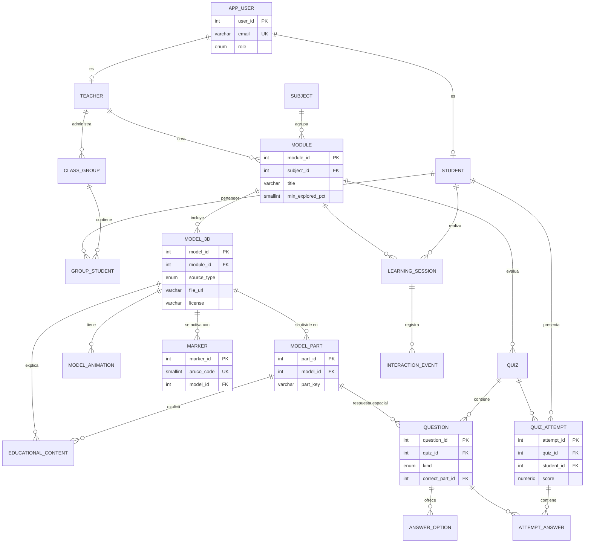

# 05 · Base de Datos — HoloClass

Motor: **PostgreSQL 16+** (SQLite para pruebas) · Script completo y probado: [`database/schema.sql`](database/schema.sql)

## 0. Cómo quedó en la implementación

El esquema ahora se **genera desde los modelos del backend** (`backend/app/models.py`, SQLAlchemy 2) con `backend/scripts/export_schema.py`, y el servidor crea las tablas y siembra el contenido de `app/data/content.json` al arrancar. Se probó completo en PostgreSQL 18 (18 tablas + 3 vistas). Diferencias respecto al diseño inicial de esta sección:

| Cambio | Motivo |
|--------|--------|
| Claves de texto `subject.key`, `module.key`, `model_3d.key`, `question.qkey` | Coinciden con `content.json` y con el frontend; la misma pregunta se identifica igual en el modo local y en el servidor |
| `model_3d.is_main`, `intro`, `scale`, `tour` (JSON), `animations` (JSON); se quitan `procedural_key` y la tabla `model_animation` | El `key` ya identifica el modelo procedural; menos tablas para lo mismo |
| `educational_content` por parte con `UNIQUE(part_id, kind)` y tipos `explicacion`, `dato_curioso`, `saber_mas` | Edición directa desde el panel docente |
| `quiz.kind` (`pre` / `post`) en lugar de `is_pretest`; `question.qtype` (`mc`, `tf`, `pick`, `order`) | Cuatro tipos de pregunta, incluida la de ordenar |
| `question.active` | Al editar un cuestionario, las preguntas retiradas se desactivan en vez de borrarse: el historial de respuestas se conserva |
| `answer_option.position` | En preguntas de ordenar guarda la posición correcta |
| `learning_session.user_id`; `interaction_event.model_key`, `part_key`, `marker_code`, `payload` (JSON); tipos extra `reaccion` y `gesto` | Registrar también reacciones químicas y gestos |
| `attempt_answer.answer` (JSON) | Guarda cualquier tipo de respuesta (índice, verdadero/falso, parte, lista ordenada) |
| `app_user.simulated` | Los datos simulados para demostrar el panel se identifican y se borran con un clic |

Las secciones siguientes conservan el razonamiento del diseño; el detalle exacto de columnas está en `database/schema.sql`.

## 1. Decisiones de diseño

1. **Usuarios con especialización por rol:** `app_user` guarda los datos comunes y el rol; `student` y `teacher` comparten la misma PK (relación 1:1). Esto evita columnas vacías y permite atributos propios de cada rol.
2. **Grupos:** un docente tiene grupos (`class_group`) con un código de 6 caracteres para que los estudiantes se unan; `group_student` es la relación N:M.
3. **Jerarquía de contenido:** `subject → module → model_3d → model_part`. Un módulo puede tener varios modelos (p. ej., el sistema solar tiene un modelo por planeta).
4. **Modelos GLB o procedurales:** `model_3d.source_type` distingue un archivo GLB de un modelo generado por código (`procedural_key` = `molecule:h2o`). Una restricción `CHECK` garantiza que cada tipo tenga su campo.
5. **El vínculo con el 3D es `model_part.part_key`**, que coincide con el nombre de la malla en el GLB. Así el raycasting del frontend se traduce directamente a un registro de la BD.
6. **Marcadores independientes de los modelos:** `marker` (diccionario + código ArUco) apunta a un modelo; puede quedar libre (`model_id NULL`) para que el docente lo asigne a un módulo nuevo sin reimprimir tarjetas.
7. **Licencias en la BD:** `model_3d` exige `license` y guarda `attribution` y `source_url` → la pantalla de créditos se genera sola.
8. **Preguntas espaciales:** `question.correct_part_id` con `CHECK` que la exige cuando `kind = 'seleccion_espacial'`; la respuesta del estudiante se guarda en `attempt_answer.selected_part_id`.
9. **Analítica de aprendizaje:** `learning_session` + `interaction_event` (con `payload JSONB` flexible) registran qué exploró el estudiante; las vistas resumen los datos para el docente.
10. **Pre-test/post-test:** `quiz.is_pretest` + vista `v_learning_gain` calculan la **ganancia normalizada de Hake**, la métrica que se usará en la prueba piloto.

## 2. Diagrama entidad-relación



## 3. Diccionario de datos

| Tabla | PK | FK | Atributos principales | Propósito |
|-------|----|----|-----------------------|-----------|
| `app_user` | user_id | — | full_name, email (UQ), password_hash, role, is_active | Cuenta de cualquier usuario |
| `teacher` | teacher_id (= user_id) | app_user | institution, department | Datos del docente |
| `student` | student_id (= user_id) | app_user | enrollment_no (UQ), grade_level | Datos del estudiante |
| `class_group` | group_id | teacher | name, join_code (UQ) | Grupos de clase |
| `group_student` | (group_id, student_id) | ambas | joined_at | Estudiantes por grupo |
| `subject` | subject_id | — | name, color_hex, icon | Materias |
| `module` | module_id | subject, teacher | title, description, level, min_explored_pct, is_published | Módulos educativos |
| `model_3d` | model_id | module | source_type, file_url / procedural_key, size_kb, triangles, scale, license, attribution, source_url | Modelos 3D |
| `model_part` | part_id | model_3d | part_key (UQ por modelo), display_name, sort_order | Partes seleccionables |
| `model_animation` | animation_id | model_3d | clip_name, display_name | Animaciones educativas |
| `marker` | marker_id | model_3d | dictionary, aruco_code (UQ), card_title, size_mm | Tarjetas físicas |
| `educational_content` | content_id | model_part / model_3d | kind, title, body, audio_url, language | Explicaciones, datos curiosos y narraciones |
| `quiz` | quiz_id | module, model_3d | title, is_pretest, time_limit_s, shuffle | Cuestionarios |
| `question` | question_id | quiz, model_part | kind, prompt, concept_tag, points, explanation | Preguntas |
| `answer_option` | option_id | question | text, is_correct, feedback | Opciones |
| `learning_session` | session_id | student, module | started_at, ended_at, avg_fps, explored_pct | Sesiones de exploración |
| `interaction_event` | event_id | session, model_part, marker | kind, payload (JSONB), created_at | Registro de interacciones |
| `quiz_attempt` | attempt_id | quiz, student, session | score, max_points, started_at, finished_at | Intentos |
| `attempt_answer` | (attempt_id, question_id) | attempt, question, option, part | is_correct, response_ms | Respuestas |

**Vistas:**
- `v_question_stats`: porcentaje de aciertos y tiempo promedio por pregunta (detecta conceptos difíciles).
- `v_part_popularity`: partes del modelo más consultadas (mapa de calor).
- `v_learning_gain`: ganancia normalizada pre/post por estudiante y módulo.

## 4. Fragmento del script

```sql
CREATE TABLE question (
    question_id      SERIAL PRIMARY KEY,
    quiz_id          INT NOT NULL REFERENCES quiz(quiz_id) ON DELETE CASCADE,
    kind             question_kind NOT NULL,
    prompt           TEXT NOT NULL,
    concept_tag      VARCHAR(60),
    correct_part_id  INT REFERENCES model_part(part_id),
    points           SMALLINT NOT NULL DEFAULT 1,
    explanation      TEXT,
    CHECK (kind <> 'seleccion_espacial' OR correct_part_id IS NOT NULL)
);

-- Ganancia normalizada de Hake: (post - pre) / (100 - pre)
CREATE VIEW v_learning_gain AS ...
```

**Validación:** el script completo se ejecutó en PostgreSQL 18 sin errores. Con los datos de ejemplo, `v_learning_gain` devuelve para el estudiante de prueba pre = 40, post = 100 y ganancia normalizada de 1.00; `v_question_stats` y `v_part_popularity` devuelven los conteos esperados.

## 5. Datos para la feria
- 3 materias, 3 módulos publicados, ~14 modelos (corazón, 9 cuerpos del sistema solar, átomo y moléculas), ~40 partes con explicaciones.
- 18 marcadores impresos + 2 libres.
- 3 cuestionarios de evaluación (8 preguntas cada uno, al menos 3 espaciales) + 3 pre-tests.
- Usuario docente demo con un grupo y los resultados reales de la prueba piloto (así el panel muestra datos verdaderos).
- Script `reset_demo.sql` para limpiar los intentos hechos por el jurado durante la feria.
