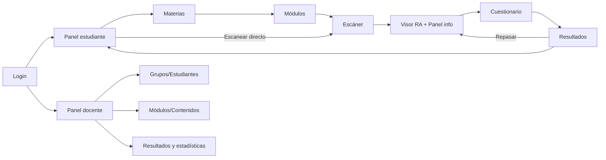

# 06 · Diseño de Interfaz — HoloClass

## 1. Sistema visual

| Elemento | Propuesta | Razón |
|----------|-----------|-------|
| Concepto | "Laboratorio holográfico": fondos oscuros azul profundo con acentos cian luminosos en el visor RA; interfaz clara y amable en paneles y cuestionarios | El modo oscuro hace resaltar los modelos 3D; los paneles claros facilitan la lectura |
| Color primario | Índigo `#4F46E5` | Tecnológico y educativo |
| Acento holográfico | Cian `#22D3EE` (contornos, selección, etiquetas) | Efecto "holograma" |
| Colores por materia | Anatomía rojo `#EF4444` · Astronomía violeta `#6366F1` · Química verde `#10B981` | Las tarjetas impresas usan el mismo color → coherencia físico-digital |
| Retroalimentación | Correcto `#22C55E` · Incorrecto `#F43F5E` · Pista `#F59E0B` | |
| Tipografía | **Space Grotesk** (títulos) + **Inter** (texto) | Moderna y legible |
| Íconos | Lucide | |
| Componentes | Tailwind + shadcn/ui; paneles tipo *glassmorphism* ligero sobre el visor | Aspecto moderno sin tapar el modelo |
| Accesibilidad | Contraste AA, botones ≥ 44 px, atajos de teclado, narración y subtítulos de la narración | Inclusión |
| Microinteracciones | Animación de entrada del modelo, brillo al seleccionar una parte, confeti al terminar el cuestionario | Motivación |

---

## 2. Pantallas

### 2.1 Inicio de sesión
- Fondo con un modelo 3D girando lentamente (corazón/planeta) en baja resolución.
- Tarjeta central: logo HoloClass (cubo holográfico), correo, contraseña, selector **Estudiante / Docente**, enlace "Unirme con código de grupo".
- Botones **"Entrar como estudiante demo"** y **"Entrar como docente demo"** para la feria.

### 2.2 Panel principal (estudiante)
- Encabezado: "¡Hola, Diego! 👋", nivel/XP y racha de días.
- Tarjeta **"Continuar donde te quedaste"** (módulo, % explorado, botón Continuar).
- Fila de **logros** (insignias: "Explorador del corazón", "Astronauta").
- Gráfica pequeña con el puntaje de los últimos cuestionarios.
- Botón flotante **📷 Escanear tarjeta**: abre el escáner sin elegir módulo; el marcador decide el módulo.

### 2.3 Selección de materias y módulos
- Tres tarjetas grandes por materia con ilustración, color, número de módulos y progreso circular.
- Al elegir una materia: lista de módulos con miniatura 3D animada al pasar el cursor, nivel, duración estimada, estado (nuevo / en progreso / completado ⭐⭐⭐) y botones **Explorar en RA** · **Explorar sin cámara**.

### 2.4 Escáner de marcadores
```
┌─────────────────────────────────────────────────────────────────┐
│ ← Volver      Corazón humano                          ⚙ Cámara │
│ ┌─────────────────────────────────────────────────────────────┐ │
│ │                                                             │ │
│ │            ┌ ─ ─ ─ ─ ─ ─ ─ ┐                                │ │
│ │              Muestra tu                                     │ │
│ │            │ tarjeta aquí  │   (marco guía animado)         │ │
│ │            └ ─ ─ ─ ─ ─ ─ ─ ┘                                │ │
│ │                                                             │ │
│ └─────────────────────────────────────────────────────────────┘ │
│  ◌ Buscando marcador…     💡 Consejo: sostén la tarjeta a 40 cm │
└─────────────────────────────────────────────────────────────────┘
```
- Estado: *Buscando* (anillo girando) → *Detectado* (contorno cian sobre el marcador + "Corazón (exterior) ✔").
- Mensajes de ayuda automáticos si no detecta en 3 s.
- Miniaturas de las tarjetas del módulo en la parte inferior (para saber cuáles mostrar).

### 2.5 Visor de realidad aumentada
```
┌──────────────────────────────────────────────────────┬─────────────────────┐
│  [VIDEO DE LA CÁMARA]                                 │ PANEL DE INFORMACIÓN │
│                                                       │                     │
│         ╭──── Ventrículo izquierdo                    │ (ver 2.6)           │
│        (  🫀  )   ← modelo 3D sobre la tarjeta        │                     │
│         ╰──── Aorta                                   │                     │
│                                                       │                     │
│  ● Seguimiento estable · 52 FPS                       │                     │
├───────────────────────────────────────────────────────┴─────────────────────┤
│ CONTROLES:  📌 Fijar  │ ▶ Latido │ 💥 Explosionar │ ✂ Corte ─●── │ 🏷 Etiquetas │ ✋ Gestos(beta) │ 📝 Cuestionario │
└──────────────────────────────────────────────────────────────────────────────┘
```
- Indicador de seguimiento con colores (verde estable / ámbar inestable / rojo perdido) y FPS.
- Al perder la tarjeta: el modelo se desvanece suavemente y aparece "Vuelve a mostrar la tarjeta o pulsa 📌 para fijarlo".
- Barra de progreso de exploración: "6 / 8 partes exploradas".

### 2.6 Panel de información del modelo
- Pestañas: **Parte** · **Recorrido guiado** · **Saber más**.
- *Parte*: nombre, ícono de color, explicación breve, "¿Sabías que…?", botón 🔊 **Escuchar** (el texto se resalta mientras se narra), botones ← → para ir a la parte anterior/siguiente.
- *Recorrido guiado*: lista de pasos numerados; el modelo enfoca y resalta cada parte automáticamente.
- *Saber más*: texto extendido, imágenes de apoyo y referencias.
- Lista de partes con ✔ en las ya exploradas.

### 2.7 Controles de interacción
| Control | Ratón/teclado | Táctil | Gesto [OPC] |
|---------|---------------|--------|-------------|
| Rotar | Arrastrar · flechas | Arrastrar con un dedo | Mano abierta y mover |
| Zoom | Rueda · `+`/`−` | Pellizco | Pellizco con dos manos |
| Seleccionar | Clic | Toque | Señalar + pellizco |
| Fijar/soltar | `F` | Botón 📌 | — |
| Animación | `Espacio` | Botón ▶ | — |
| Siguiente parte | `→` | Botón → | Deslizar |
- Ayuda contextual "?" con un diagrama de los controles.

### 2.8 Cuestionario
- Pantalla dividida: **modelo 3D a la izquierda** (sigue interactivo) y **pregunta a la derecha**.
- Pregunta de opción múltiple: 4 botones grandes; al responder, el correcto se pone verde y aparece la retroalimentación.
- **Pregunta espacial:** "Toca en el modelo la cavidad que bombea sangre al cuerpo" → el cursor cambia a mira 🎯; al tocar una parte se resalta y se pide **Confirmar**; si falla, se ilumina en verde la correcta.
- Barra de progreso (pregunta 3 de 8), temporizador opcional y puntaje acumulado.

### 2.9 Resultados
- Puntaje grande con estrellas ⭐⭐⭐ y confeti si ≥ 80 %.
- Desglose por concepto (barras): "Estructura 100 % · Circulación 50 %".
- Lista de preguntas con ✔/✖ y botón **"Ver en el modelo"** que lleva a la parte relacionada.
- Si hubo pre-test: comparación **"Antes 40 % → Ahora 90 %"**.
- Botones: **Repasar partes falladas** · **Intentar de nuevo** · **Siguiente módulo**.

### 2.10 Panel docente (HoloTeacher)
- Barra lateral: Resumen · Grupos · Estudiantes · Módulos · Contenidos · Resultados · Créditos.
- **Resumen:** KPIs (estudiantes activos, sesiones de la semana, promedio de calificación, tiempo medio de exploración), gráfica de actividad semanal, **"Concepto más difícil"** (pregunta con menor % de aciertos y la parte del modelo asociada).
- **Grupos/Estudiantes:** tabla con búsqueda, importación CSV, código de grupo para compartir, progreso por estudiante (barras por módulo).
- **Módulos:** tarjetas con estado publicado/borrador; asistente "Nuevo módulo" en 4 pasos: (1) datos, (2) subir GLB → vista previa 3D con sus mallas listadas, (3) nombrar partes y asignar marcador libre, (4) escribir explicaciones y preguntas.
- **Contenidos:** editor de texto por parte con vista previa en 3D al lado; editor de preguntas (tipo, opciones, parte correcta seleccionándola en el modelo).
- **Resultados:** tabla por cuestionario, mapa de calor de partes consultadas y ganancia pre/post del grupo.

---

## 3. Mapa de navegación



## 4. Herramientas
Figma (wireframes S1, alta fidelidad S2) · Canva/Figma para las tarjetas impresas · Prototipo navegable para pruebas tempranas con 3–5 estudiantes en la semana 3.
