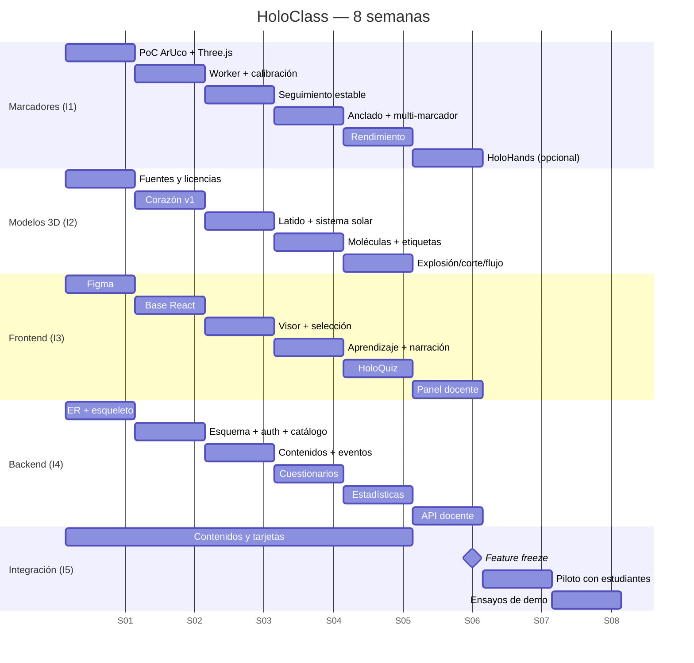
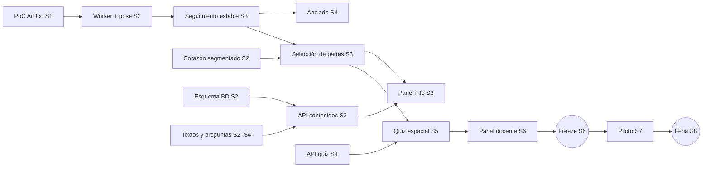

# 07 · Cronograma y Presupuesto — HoloClass

## 1. Roles

| # | Rol | Responsabilidades |
|---|-----|-------------------|
| **I1** | Reconocimiento de marcadores y cámara | HoloScan (js-aruco2, Worker), pose, calibración con OpenCV, filtro One-Euro, pérdida de seguimiento, motor RA (cámara virtual sobre video), [OPC] HoloHands |
| **I2** | Modelos 3D y Blender | Fuentes y licencias, segmentación, animaciones, optimización GLB, sistema solar y moléculas procedurales (con I1), etiquetas |
| **I3** | Frontend y experiencia de usuario | Figma, React, todas las pantallas, interacción (raycasting, controles), panel de información, cuestionario, panel docente |
| **I4** | Backend y base de datos | Esquema PostgreSQL, FastAPI, auth y roles, contenidos, calificación, analítica, asistente de módulos |
| **I5** | Integración, pruebas y contenido educativo | Textos por parte (revisados con un docente de ciencias), preguntas, narraciones, tarjetas impresas, pruebas técnicas, prueba piloto, guion de demo |

## 2. Cronograma de 8 semanas

| Semana | I1 · Marcadores/cámara | I2 · Modelos 3D | I3 · Frontend/UX | I4 · Backend/BD | I5 · Integración/contenido | **Entregable** |
|--------|------------------------|-----------------|------------------|-----------------|----------------------------|----------------|
| **1** Planeación y pruebas de concepto | Prueba: js-aruco2 detecta un marcador impreso y dibuja un cubo con Three.js | Buscar modelos, registrar licencias; exportar uno de prueba a GLB | Wireframes Figma de las 10 pantallas; guía de estilo | Modelo ER; FastAPI esqueleto; Postgres | Repo, kanban, plan de pruebas; selección de temas con un docente asesor | **Prueba de concepto RA (cubo sobre la tarjeta)**, ER, wireframes |
| **2** Base técnica | Worker de detección; generar marcadores con OpenCV; calibrar cámara (ChArUco) | Corazón segmentado y nombrado (v1); texturas de planetas | Proyecto React + R3F; login, panel, materias | `schema.sql`, auth JWT/roles, endpoints de catálogo | Redactar contenidos del corazón; diseño de tarjetas v1 | Modelo del corazón en el visor; API de catálogo en Swagger |
| **3** RA estable | Filtro One-Euro, máquina de estados de seguimiento, multi-marcador | Latido; sistema solar procedural con órbitas | Visor RA + selección de partes (raycasting) + panel de información | Contenidos por parte y sesiones/eventos | Imprimir tarjetas v1; pruebas de detección (distancia/ángulo/luz) | **Corazón en RA seleccionable con explicaciones** |
| **4** Tres módulos | Modo Anclado; guía de calidad de imagen; comparación de 2 marcadores | Moléculas + Bohr (con I1); etiquetas (*Empties*) | Recorrido guiado, narración TTS, controles de interacción | Cuestionarios: preguntas, opciones, calificación en servidor | Contenidos de astronomía y química; banco de preguntas | **3 módulos navegables en RA** |
| **5** Evaluación | Optimización de rendimiento (pixelRatio, calidad adaptativa) | Vista explosionada, corte, flujo sanguíneo | HoloQuiz completo (incl. selección espacial) + resultados | Pre/post-test, estadísticas, vistas | Narraciones MP3 del corazón; pruebas de integración | **Ciclo completo: explorar → cuestionario → resultados** |
| **6** Docente y *feature freeze* | [OPC] HoloHands en modo Anclado; decisión según FPS | [OPC] cerebro / interacción H+O; optimización final | Panel docente (resumen, grupos, resultados, editor de contenidos) | API docente, asistente de módulos (subir GLB) | **Congelar alcance**; pruebas de regresión; lista de bugs | **MVP completo**; decisión de opcionales |
| **7** Prueba piloto y pulido | Ajustes de detección con la luz del lugar de la feria | Ajustes visuales según retroalimentación | Pulido, accesibilidad, animaciones, pantalla de créditos | Corrección de bugs; datos demo; `reset_demo.sql` | **Prueba piloto con ≥ 20 estudiantes** (pre/post, SUS, motivación) | Informe del piloto y KPIs medidos |
| **8** Feria | Plan B: modo sin cámara probado; laptop de respaldo calibrada | Video de respaldo con capturas | Póster y diapositivas | Documentación de la API | Ensayos cronometrados (≥ 10); tarjetas de repuesto; stand | **Versión final, póster, presentación, video, documento técnico** |

### Gantt

*(Fechas ilustrativas; ajustar al calendario real.)*

## 3. Dependencias críticas

**Mitigación:** desde la semana 1 el frontend trabaja con un modelo GLB de prueba y con el modo sin cámara (OrbitControls), así la UI no depende de que la RA esté terminada; la RA solo "reemplaza la fuente de la pose". Los textos y preguntas se redactan en una hoja compartida desde la semana 1.

## 4. Presupuesto (pesos mexicanos)

### 4.1 Software — $0

Three.js, React, js-aruco2, OpenCV, MediaPipe, Blender, gltf-transform, FastAPI, PostgreSQL, Figma (educación), Canva (educación), GitHub Student Pack: **todos gratuitos**. Modelos y texturas: solo con licencia CC0/CC BY o dominio público → **$0**.

### 4.2 Hardware y materiales

| Concepto | Cant. | Costo aprox. | Total | ¿Obligatorio? |
|----------|-------|--------------|-------|---------------|
| Laptops del equipo | 5 | ya disponibles | $0 | — |
| Impresión de tarjetas a color en cartulina (3 juegos × 20 tarjetas) | 60 | $8 | $480 | Sí |
| Enmicado **mate** de tarjetas | 60 | $7 | $420 | Sí |
| Impresión del tablero de calibración ChArUco (foam board) | 1 | $150 | $150 | Sí |
| Webcam USB 1080p con buen enfoque | 1 | $450 – $700 | $600 | Recomendado |
| Monitor/pantalla para el público (préstamo de la escuela) | 1 | $0 – $300 | $0 | Recomendado |
| Aro de luz LED con tripié | 1 | $300 – $500 | $400 | Recomendado |
| Bocinas pequeñas (narración audible en la feria) | 1 | $250 | $250 | Recomendado |
| Soporte/atril para tarjetas (exhibición) | 2 | $80 | $160 | Opcional |
| Póster 90×120 cm | 1 | $450 | $450 | Sí |
| Tarjetas de presentación con QR para el público | 100 | $2 | $200 | Opcional |
| Mouse inalámbrico para el jurado | 1 | $150 | $150 | Recomendado |
| Imprevistos (10 %) | — | — | $330 | — |
| **Total recomendado** | | | **≈ $3,590 MXN** | |

**Escenario mínimo** (solo obligatorios: tarjetas, enmicado, tablero, póster): **$1,500 MXN** + 10 % imprevistos ≈ **$1,650 MXN** (≈ $330 por integrante).
**Escenario recomendado:** **≈ $3,590 MXN** (≈ $720 por integrante).

*(Precios de referencia en México; verificar al comprar.)*

### 4.3 Valor del trabajo (para el análisis de comercialización)
5 integrantes × 8 semanas × 12 h = **480 h**; a $80 MXN/h ≈ **$38,400 MXN** de valor de desarrollo, más el valor del contenido educativo y los modelos preparados.
